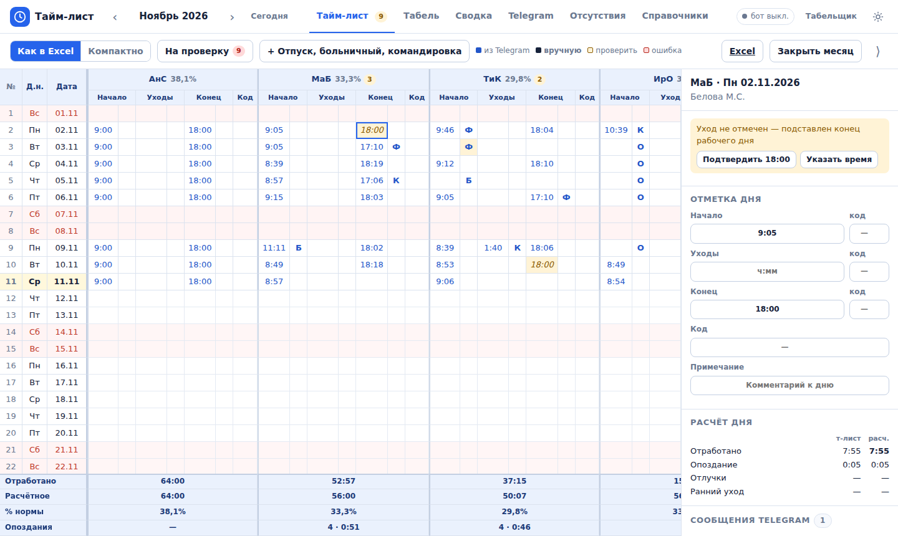
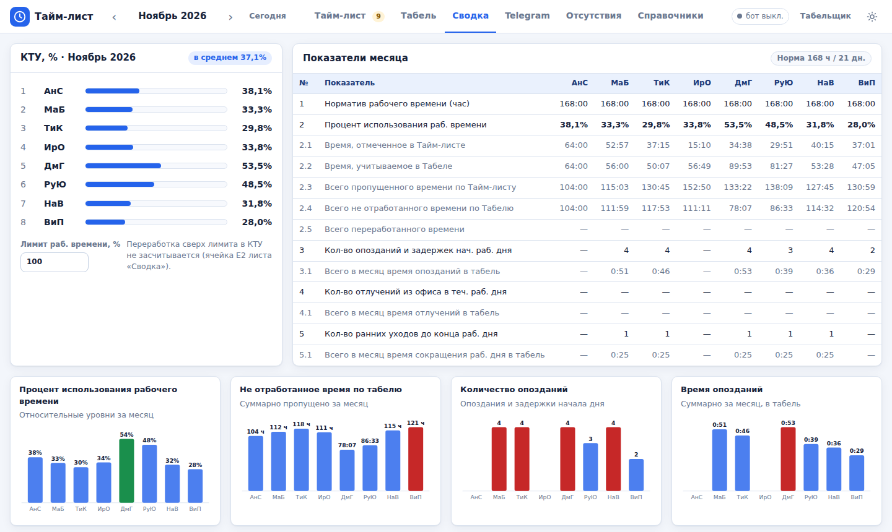
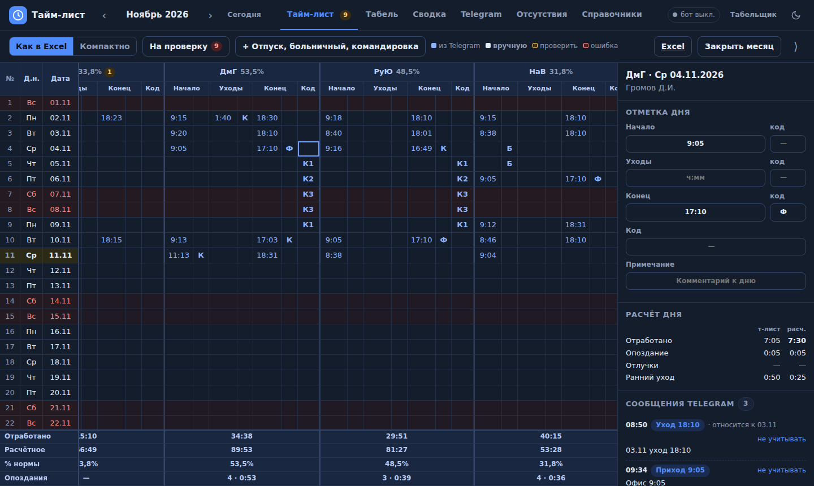

# Тайм-лист

Учёт рабочего времени по сообщениям в рабочей группе Telegram: бот читает группу, сам
расставляет отметки прихода и ухода, считает табель и сводку КТУ. Замена книги Excel
`TimeList-ГГГГ-М.xlsm` — с теми же колонками и теми же формулами, но без ручного переноса
сообщений в таблицу.

Одна программа на Rust: Telegram-бот, расчётное ядро, REST API и веб-интерфейс
(светлая и тёмная темы). Данные хранятся в одном файле SQLite.



| Сводка и КТУ | Тёмная тема |
|---|---|
|  |  |

## Что изменилось по сравнению с Excel

| Было | Стало |
|---|---|
| Копировать чат порциями по 100 сообщений на лист «Telegram» | Бот получает сообщения сам, в момент отправки |
| Выбирать сотрудника, читать его статусы и вручную вбивать «Начало», «Конец» и коды | Отметки и коды причин расставляются автоматически |
| Проставлять «О», «Б», «К» в каждой строке отпуска, больничного, командировки | Один период с датами — код появляется во всех рабочих днях |
| Сбой, если имя в Telegram отличается от имени в «Списке» | Сотрудник определяется по Telegram ID |
| Новый файл на каждый месяц | Все месяцы в одной базе, закрытый месяц замораживается |
| История правок — отключённый макрос | Журнал: кто, когда и что изменил |

Расчёт «Табеля» и «Сводки» повторяет формулы книги и сверен с тремя реальными месяцами
(см. [как устроена книга](docs/EXCEL.md) и раздел «Разработка»).

## Быстрый старт

Нужен [Rust](https://rustup.rs) 1.82 или новее и компилятор C (SQLite собирается из исходников).

```bash
cargo build --release
cp .env.example .env                    # настройки; для первого знакомства можно не трогать

./target/release/timelist demo          # вымышленные сотрудники и месяц переписки
./target/release/timelist               # интерфейс: http://127.0.0.1:8080
```

Команда `demo` заполняет только пустую базу. Чтобы начать с чистого листа, удалите
`data/timelist.db` или укажите другой файл: `--db data/work.db`.

## Перенос данных из Excel

```bash
./target/release/timelist import TimeList-2026-8.xlsm TimeList-2026-9.xlsm TimeList-2026-10.xlsm
```

То же самое — кнопкой в разделе «Справочники → Excel». Из книги берутся сотрудники
(Ф.И.О., ник, имя в Telegram), коэффициенты причин, нормы времени, лимит КТУ, отметки месяца
и сообщения с листа «Telegram». Отметки импортируются как введённые вручную, поэтому
цифры месяца совпадают с книгой один в один.

Обратно — кнопка «Excel» в тайм-листе или `timelist export 2026-10`: книга с листами
«TimeList», «Табель» и «Сводка».

## Подключение Telegram-бота

1. Напишите [@BotFather](https://t.me/BotFather): `/newbot`, получите токен.
2. Там же: `/setprivacy` → выберите бота → **Disable**. Иначе бот видит в группе только
   команды. (Либо сделайте бота администратором группы.)
3. Запишите токен в `.env`: `TELEGRAM_BOT_TOKEN=...` и перезапустите программу.
4. Добавьте бота в рабочую группу. Если режим приватности меняли после добавления —
   удалите бота из группы и добавьте заново.
5. Привяжите людей к сотрудникам: раздел «Telegram → Привязка сотрудников». Каждый, кто
   написал в группу, появляется там с подсказкой «кто это»; достаточно нажать «Привязать».
   ID можно вписать и вручную в «Справочниках»; свой ID сотрудник узнаёт командой `/id`.
6. По желанию ограничьте бота одной группой: `TELEGRAM_CHAT_ID=-100…` (ID показывает `/id`
   и карточка «Бот»).

Бот работает через long polling: входящий адрес, вебхуки и открытые порты не нужны.
На понятое сообщение он ставит реакцию ✍, на непонятое — 🤔, на сообщение человека, которого
нет в справочнике, — 🤷 (отключается: `TELEGRAM_REACTIONS=false`).

Команды бота: `/me` — мои отметки за сегодня и итог месяца, `/id` — мой Telegram ID и ID чата,
`/help` — памятка.

### Что писать в группу

| Сообщение | Что получится |
|---|---|
| `офис`, `в офисе` | Начало — время сообщения |
| `офис 9:10`, `офис 9,30`, `уход 17.30` | Время берётся из текста |
| `17.09 уход 18:00`, `вчера уход 19:40` | Отметка задним числом |
| `офис до банк`, `офис, со встречи у заказчика` | Начало с кодом **К** — опоздание не штрафуется |
| `задержусь у врача` → позже `офис` | Начало с кодом **Б** |
| `задержусь по семейным` → `офис` | Начало с кодом **Ф** |
| `болею`, `отсутствую по состоянию здоровья` | **Б** на весь день |
| `отгул`, `завтра не выйду, отгул` | **Г** на весь день |
| `отпуск с 12.11 по 20.11` | **О** на рабочие дни периода |
| `выезд на объект` → `вернулся` | «Уходы» — длительность отлучки с кодом **К** |
| `уход`, `убыл`, `закончили на сегодня` | Конец — время сообщения |
| `уход с объекта`, `уход из аэропорта` | Конец с кодом **К** |
| `я, Дима и Игорь на объекте` | Отметка автору и всем упомянутым (имена и уменьшительные — в «Псевдонимах» сотрудника) |

Время события — время отправки, если в тексте не указано другое. Отредактированное
сообщение пересчитывается. Проверить любую фразу можно в разделе «Telegram → Проверить фразу».

### Что остаётся человеку

Автоматика ничего не скрывает: всё сомнительное попадает в список **«На проверку»** с кнопками
быстрого исправления.

| Ситуация | Что сделает программа | Что предложит |
|---|---|---|
| Есть «офис», нет «уход» | После конца дня подставит 18:00 | «Подтвердить 18:00» или указать время |
| Есть «уход», нет «офис» | День не считается, ячейка красная | Поставить 9:00 или указать время |
| «Отсутствую» без причины | Код **Ф** | Подтвердить или выбрать другой код |
| Предупредил об опоздании и не пришёл | Отсутствие с кодом из сообщения | Подтвердить или изменить |
| Сообщение не распознано | Ничего | Отметить день проверенным, не учитывать сообщение |
| Рабочий день без отметок | Ничего | Проставить код или «так и должно быть» |

Отпуска, больничные и командировки вносятся периодом: кнопка «+ Отпуск, больничный,
командировка». Иногородняя командировка с тарифом расставляет **К1** в дни дороги, **К2** в
рабочие дни и **К3** в выходные.

Ручная правка всегда важнее автоматики и не перезаписывается новыми сообщениями. Вернуть
значение из сообщений — «↺ Вернуть авто» в панели дня. Сотруднику, который не отмечается в
группе, включите «Без отметок» в справочнике: в рабочие дни ему ставится полный день.

## Интерфейс

- **Тайм-лист** — сетка «дни × сотрудники» с колонками книги: Начало, код, Уходы, код,
  Конец, код, Код. Итоги внизу пересчитываются после каждой правки. Справа — панель дня:
  сообщения сотрудника, расчёт, история изменений.
- **Табель** — показатели месяца (строки 3–18 листа «Табель») и разбивка по дням.
- **Сводка** — КТУ, таблица показателей и диаграммы «относительных уровней».
- **Telegram** — лента сообщений с тем, как их понял бот; привязка сотрудников; вставка
  скопированного чата; проверка фразы.
- **Отсутствия** — периоды отпусков, больничных, командировок.
- **Справочники** — сотрудники, коэффициенты, график дня, нормы и праздники, импорт Excel.

Клавиатура в сетке: стрелки и Tab — перемещение, Enter или просто ввод — правка, Delete —
очистить, Esc — отмена. Время вводится как `930`, `9.30`, `9,30` или `9:30`. Коды можно
набирать в латинской раскладке — программа поймёт, что `,` это **Б**.

Цвет ячейки: синий — из Telegram, тёмный жирный — введено вручную, жёлтый — стоит проверить,
красный — ошибка (как условное форматирование в книге).

## Настройки

Переменные окружения или файл `.env` (см. [.env.example](.env.example)); те же параметры
доступны как аргументы командной строки — `timelist --help`.

| Переменная | По умолчанию | Назначение |
|---|---|---|
| `TIMELIST_DB` | `data/timelist.db` | Файл базы данных |
| `TIMELIST_LISTEN` | `127.0.0.1:8080` | Адрес интерфейса и API |
| `TIMELIST_PASSWORD` | — | Пароль интерфейса |
| `TIMELIST_API_TOKEN` | — | Токен для интеграций (`Authorization: Bearer …`) |
| `TELEGRAM_BOT_TOKEN` | — | Токен бота; без него работает только интерфейс |
| `TELEGRAM_CHAT_ID` | любая группа | ID рабочих групп через запятую |
| `TELEGRAM_REACTIONS` | `true` | Реакции бота на сообщения |
| `TIMELIST_ASSETS_DIR` | встроенные | Каталог с файлами интерфейса для доработки без пересборки |

График дня (9:00–18:00, обед 1:00), лимит КТУ, часовой пояс (UTC+5) и коэффициенты причин
меняются в «Справочниках». Производственный календарь Узбекистана на 2026 год уже внесён;
для других лет норма считается по календарю (Пн–Пт минус праздники), её можно задать вручную.

> **Доступ.** По умолчанию программа слушает только `127.0.0.1`. Если открываете её в сеть
> (`TIMELIST_LISTEN=0.0.0.0:8080`), обязательно задайте `TIMELIST_PASSWORD`: в базе
> персональные данные и причины отсутствия сотрудников. Шифрование (HTTPS) обеспечивает
> обратный прокси перед программой.

## Интеграция с CRM

Интерфейс — обычный клиент REST API, поэтому CRM может делать всё то же самое. Запросы
авторизуются заголовком `Authorization: Bearer <TIMELIST_API_TOKEN>`.

| Запрос | Что делает |
|---|---|
| `GET /api/month/2026-10` | Месяц целиком: дни, сотрудники, отметки, расчёт дня, табель, сводка, КТУ |
| `PUT /api/marks/{сотрудник}/{дата}` | Правка отметки: `{"set": {"start": "9:30", "start_code": "Б"}}`, `{"reset": ["all"]}`, `{"note": "…"}`, `{"reviewed": true}`; в ответе — пересчитанный месяц |
| `GET /api/day/{сотрудник}/{дата}` | Сообщения дня, автоматическая отметка, история правок |
| `GET /api/messages?ym=2026-10` | Сообщения месяца с результатом разбора |
| `POST /api/messages`, `POST /api/messages/import` | Добавить сообщение вручную / вставить скопированный чат |
| `POST /api/parse` | Как бот поймёт фразу: `{"text": "офис 9:10"}` |
| `GET/POST /api/periods`, `DELETE /api/periods/{id}` | Периоды отсутствия |
| `GET/POST /api/employees`, `PUT/DELETE /api/employees/{id}` | Сотрудники |
| `GET /api/codes`, `PUT /api/codes/{код}` | Причины и коэффициенты |
| `GET/PUT /api/settings`, `GET /api/calendar/{год}` | График дня, нормы, праздники |
| `POST/DELETE /api/months/{месяц}/lock` | Закрыть / открыть месяц |
| `GET /api/export/2026-10` | Месяц в .xlsx |
| `GET /api/events` | Поток событий (SSE): данные изменились |

Время в ответах — минуты от полуночи (`540` = 9:00), длительности — минуты (дробные).
Заголовок `X-Timelist-User` (percent-encoding) задаёт имя для журнала изменений.

Расчёт можно встроить и без сервера: крейт `timelist-core` не зависит от базы, сети и
интерфейса.

```rust
use timelist_core::calc::{calc_day, calc_svodka, calc_tabel};
use timelist_core::{Mark, Rules};

let rules = Rules::default();                      // 9:00–18:00, обед 1:00, коэффициенты книги
let day = Mark { start: Some(10 * 60 + 49), start_code: Some("Б".into()), end: Some(18 * 60 + 9), ..Mark::default() };
let calc = calc_day(&day, &rules);                 // отработано 6:20, расчётное 7:47
let tabel = calc_tabel(&[calc], 168.0);
let svodka = calc_svodka(&tabel, 168.0, 1.0);      // КТУ и показатели «Сводки»
```

Интерфейс без сборки и зависимостей: три файла в `crates/server/assets`. Цвета вынесены в
переменные CSS (`:root` и `:root[data-theme="dark"]`), так что перекрасить под CRM можно,
не трогая остальное.

## Отличия от книги

Формулы перенесены как есть; сознательных отступлений четыре.

1. **«Конец» без «Начала».** Книга считает такой день как `Конец − обед` (около 17 часов).
   Здесь день даёт 0 и помечается ошибкой, пока время прихода не указано.
2. **Суммы больше суток.** В «Сводке» строки 3.1, 4.1 и 5.1 имеют формат `ч:мм`, поэтому
   27:59 в книге отображается как 3:59. Здесь показывается полное число часов.
3. **Длина рабочего дня.** В книге это `$A$1-$D$1` (начало дня минус обед), что равно
   8 часам только при графике 9:00–18:00. Здесь — `конец − начало − обед`.
4. **Неизвестный код** не превращает итоги в `#Н/Д`: ввод такого кода отклоняется.

Правила с листа «Список», которых нет в формулах книги (автоматические 8 часов для учебного
отпуска с доплатой 50 % отработанного, лимит 14 дней учебного отпуска), в программу не
добавлены — расчёт совпадает с книгой.

## Разработка

```
crates/core      расчётное ядро: формулы (calc), разбор сообщений (parser),
                 автоматическая расстановка отметок (automark), календарь
crates/server    программа: база (db), сборка месяца (service), REST API (api),
                 бот (bot), обмен с Excel (excel), интерфейс (assets)
docs/EXCEL.md    как устроена исходная книга и как её листы соответствуют программе
```

```bash
cargo test --workspace
cargo clippy --workspace --all-targets -- -D warnings
TIMELIST_ASSETS_DIR=crates/server/assets cargo run    # правки интерфейса видны без пересборки
```

Тест `crates/core/tests/golden.rs` сверяет расчёт дня с книгой: в фикстуре — 451 уникальная
отметка дня из трёх месяцев (без имён, дат и привязки к сотруднику) и значения колонок
«Табеля», которые для неё посчитал Excel. Итоги табеля, показатели сводки и КТУ сверялись
с книгами целиком при переносе (импорт → API → сравнение с ячейками книги); в репозитории
их формулы покрыты тестами в `calc.rs`. Бот проверяется на подставном Bot API
(`crates/server/src/bot.rs`).

Файлы базы и книги Excel в репозиторий не попадают (`.gitignore`): в них персональные данные.
